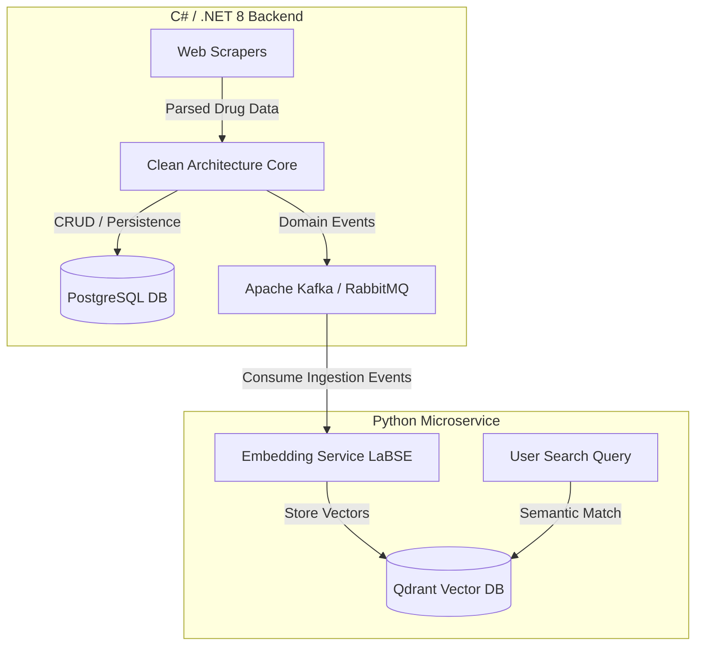

# 🌐 DrugsEngine Ecosystem

Инженерная экосистема для сбора, агрегации, поиска и семантической векторизации медикаментов и аптечной номенклатуры.



---

## 📦 Компоненты системы

| Репозиторий / Модуль | Стек | Описание |
| :--- | :--- | :--- |
| [**DrugsEngine**](./DrugsEngine) | .NET 8, EF Core, PostgreSQL, OData, Kafka | Основной бэкенд, Clean Architecture, CQRS, парсинг аптек |
| [**DrugsEnginePythonService**](./pythonProject2) | Python 3.10, Qdrant, LaBSE, Kafka, RabbitMQ | Микросервис генерации векторных эмбеддингов и семантического поиска |
| [**SharedServices**](./SharedServices) | Docker Compose, Kafka, Zookeeper, RabbitMQ | Инфраструктурные сервисы шин сообщений и брокеров |

---

## 🚀 Быстрый запуск всей экосистемы

1. **Запуск инфраструктурных брокеров (Shared Services)**:
   ```bash
   cd SharedServices
   docker-compose up -d
   ```

2. **Запуск Python сервиса векторизации & Qdrant**:
   ```bash
   cd ../pythonProject2
   docker-compose up -d --build
   ```

3. **Запуск .NET бэкенда**:
   ```bash
   cd ../DrugsEngine/Infrastructure
   dotnet ef database update
   dotnet run
   ```

---

## 👨‍💻 Автор & Контакты
- **Даниил Гандапас** (Asm-o-Dan)
- GitHub: [github.com/Asm-o-Dan](https://github.com/Asm-o-Dan)
- Email: [dgandapas1@gmail.com](mailto:dgandapas1@gmail.com)
